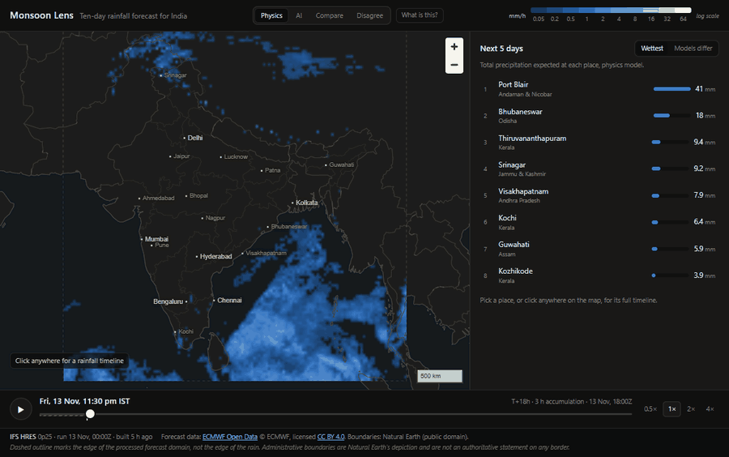
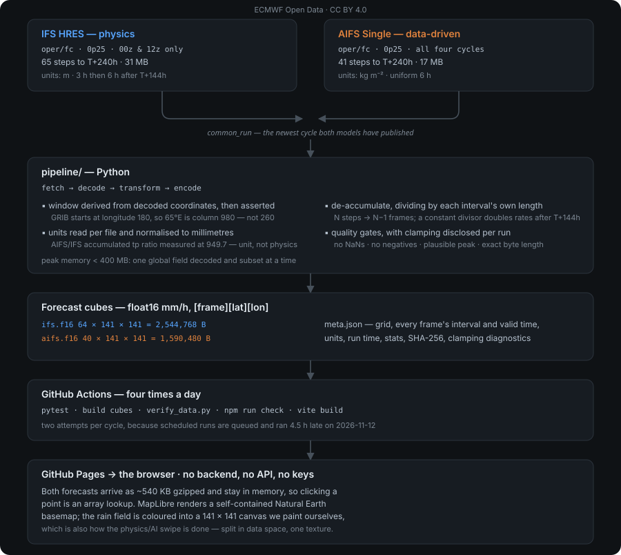

# Monsoon Lens

**Ten-day precipitation forecast for India, built from ECMWF Open Data.**

Live: **https://lakshyakaviya.github.io/quest_lab_precipitation_forecast_app/**

Built for the QUEST Lab Full Stack AI pre-doctoral application by Lakshya Kaviya,
November 2026.



*Recorded from a production build of this commit, on the 2026-11-13 00Z run. The point it
settles on is Chennai, where the AI model expects 179 mm and the physics model 13 mm — the
case examined below.*

---

## What it does

Fetches total precipitation from ECMWF twice a day — from **both** its physics model
and its AI model — converts them into compact forecast cubes for the India region, and
serves an animated map where you can scrub through the next ten days, click anywhere
for a rainfall timeline, and put the two forecasts against each other.

- **Animated rain field** over India at 0.25° (~28 km), T+3h to T+240h.
- **Physics vs AI.** IFS HRES (physics) and AIFS Single (data-driven), always from the
  same analysis time. Four views: either model alone, a draggable swipe between them,
  and a diverging **disagreement** layer showing where and by how much they part company.
- **Time scrubber** with play/pause, speed control, and keyboard control
  (`space`, `←`/`→`, `Home`/`End`). It opens on the present moment, and the part of the
  forecast that has already elapsed is marked as past throughout the UI.
- **Click anywhere** for that cell's rainfall from both models: rate over time,
  cumulative build-up, peak intensity, when the rain starts, a plain-language verdict
  on whether the models agree, and a table view.
- **Rankings** over the next five days across 44 places: wettest, and — more
  interestingly — the places the two models most disagree about, which is otherwise
  something you have to hunt for by dragging the swipe around.
- **Every view is a link.** Mode, time, selected point and divider position live in the
  URL. Frames are addressed by lead time rather than index, so a link keeps pointing at
  the same forecast moment as new runs replace old ones.
- **No backend.** Both forecasts together are a little over 500 KB on the wire, so every
  query is an array lookup in the browser.

### What the comparison shows

AI weather models are known to produce smoother, less extreme precipitation than
physics models, and the app makes that visible rather than asserting it. On the
2026-11-13 00Z run over India:

| | IFS HRES (physics) | AIFS Single (AI) |
|---|---|---|
| Peak rate | 66.1 mm/h | 11.5 mm/h |
| Share of cells raining | 14% | 19% |

Both figures are **recomputed for every run** and shown live in the app's "What is this?"
panel; they are read from each run's `meta.json`, never hardcoded. The two behave quite
differently run to run — the peak is a single cell out of 1.27 million and moves by a few
mm/h each cycle, while the wet area averages over the whole cube and barely moves, which
is why the 12Z and 00Z runs both round to 14% and 19% even though their peaks differ.
The direction is the stable part: the AI model spreads rain over a wider area at lower
intensity. In the swipe view the physics side is granular and speckled while the AI side
is made of large smooth blobs.

#### A worked case: the Bay of Bengal system heading for the Andhra coast

The 2026-11-13 00Z run contains the clearest example of why the comparison is worth
building. Both models carry an organised system that forms in the southern Bay of Bengal
around 14 November and tracks north-west for the next five days. They disagree about
almost everything that matters about it.

Tracking the wettest cell in a box over the Bay (8–22°N, 80–92°E) at matching valid
times:

| Valid (UTC) | IFS HRES core | AIFS Single core | Separation |
|---|---|---|---|
| 15 Nov 00Z | 8.75°N 84.00°E, 23.2 mm/h | 8.25°N 83.25°E, 8.4 mm/h | ~100 km |
| 16 Nov 06Z | 12.50°N 84.75°E, **43.9 mm/h** | 11.75°N 83.25°E, 6.9 mm/h | ~180 km |
| 18 Nov 12Z | 14.75°N 84.25°E, 37.9 mm/h | 12.50°N 82.25°E, 9.1 mm/h | ~330 km |
| 19 Nov 18Z | 17.00°N 82.50°E, **40.1 mm/h** | 14.75°N 80.00°E, 6.4 mm/h | ~370 km |

The physics model drives a tight, intensifying core up the middle of the Bay and brings it
onto the coast near **Visakhapatnam** around 19–20 November. The AI model keeps a weak,
broad smear that drifts west and comes ashore near **Nellore and Chennai** instead. By day
six the two cores are **370 km apart** and differ **six-fold** in peak intensity.

Where that lands is close to a mirror image. Totals over the whole forecast
(T+0h → T+240h) at the coastal cells:

| | IFS HRES (physics) | AIFS Single (AI) |
|---|---|---|
| Visakhapatnam (17.69°N, 83.22°E) | **181 mm** | 42 mm |
| Nellore (14.44°N, 79.99°E) | 7 mm | **179 mm** |
| Chennai (13.08°N, 80.27°E) | 14 mm | **180 mm** |

Each model puts about 180 mm on the coast. They disagree by roughly **500–600 km** about
*which* coast — and so about which few million people should be paying attention. Both
started from the **same analysis at the same hour**; the divergence is the models, not
their initial conditions. That is the whole argument for showing them side by side rather
than picking one and presenting it as the forecast.

Four things this example does **not** show, which matter as much as what it does:

- **It is a precipitation signature, not a confirmed cyclone.** This app ingests `tp`
  alone — no wind, no mean sea-level pressure — so it can show an organised, slowly
  tracking rainfall core consistent with a tropical system, and nothing more. Calling it a
  cyclone would be reading more into one field than it carries. India's official
  designations come from the IMD, not from here.
- **The divergence sits at day 6–7 lead time**, where deterministic forecasts have little
  skill and tracks routinely shift by hundreds of kilometres between runs. Both forecasts
  will have changed by the time you read this.
- **The five-day board only catches the edge of it.** The "Models differ" board covers
  the next five days, and inside that window Visakhapatnam is at 0 mm in *both* models —
  the landfall is at day 6–7. The board does surface the system, but as Chennai at
  2.2 vs 19 mm, which is the first few hours of a 180 mm disagreement. Reading the
  magnitude of this case needs the map and the point timeline, not the rankings.
- **Neither model is ground truth.** This app never verifies either against observations,
  so it can show *that* they disagree, never which one is right.

Earlier runs show the same pattern at shorter range: on the 2026-11-12 12Z run the physics
model expected **20 mm** over Bhubaneswar in the next five days where the AI model expected
**0 mm**. The "Models differ" board exists to surface cases like that one.

## How it works



Full detail, including every figure quoted here and how it was checked, is in
**[docs/METHODS.md](docs/METHODS.md)**.

```
ECMWF Open Data ──▶ IFS  GRIB2 (65 steps, 31 MB) ──▶ ifs.f16   64 frames, 2.54 MB
                └─▶ AIFS GRIB2 (41 steps, 17 MB) ──▶ aifs.f16  40 frames, 1.59 MB
                         de-accumulate · normalise units · subset to India
                         meta.json: valid times, interval lengths, provenance
                                           │
            GitHub Actions ──twice daily──▶ build the web app ──▶ GitHub Pages
```

**The data.** ECMWF's `tp` (total precipitation) is *accumulated from the start of the
forecast*. The pipeline differences consecutive steps and divides each difference by its
own interval length — which matters because IFS changes step spacing from 3 h to 6 h at
T+144h, so a constant divisor would overstate rain rates across the whole second half of
the forecast. 65 accumulation steps therefore become **64 interval frames**, each
labelled by the valid time at the *end* of its interval.

**Units differ by model and are read from the file, never assumed:** IFS publishes `tp`
in **metres**, AIFS Single in **kg m⁻²** (numerically millimetres). Treating an AIFS
field as metres overstates rainfall by 1000×. Everything downstream of `decode` works in
millimetres.

Values are stored as a **rain rate in mm/h** rather than an interval total, so one
physical quantity spans both the spacing change and the two models' different
resolutions; the app multiplies back up by each frame's interval length to show mm/3h
or mm/6h.

**Comparing fairly.** The two models' newest complete runs do not line up — AIFS is
released sooner and runs all four cycles, while IFS reaches day 15 only at 00z and 12z —
so the pipeline resolves one shared run for both and refuses to pretend otherwise.
Differences are computed over **6-hourly windows**, the coarsest interval the two share,
by averaging the finer model up rather than interpolating the coarser one down.

**The front end.** The India window is 141 × 141 cells, small enough that the entire
forecast ships to the browser as one float16 array. The field is coloured through a
log-scaled single-hue ramp into a 141 × 141 canvas and handed to MapLibre as a raster
source. The basemap is a 157 KB Natural Earth extract bundled into the app — no tile
server, no API key, no glyph server, nothing to rate-limit.

## Running it locally

Requires Python 3.11+ and Node 20.19+.

```bash
# 1. Pipeline
python -m venv .venv
.venv/Scripts/activate            # Windows;  source .venv/bin/activate elsewhere
pip install -e "./pipeline[dev]"
pytest pipeline/tests             # 45 tests, no network needed

python -m precipitation.cli latest                        # what runs are published
python -m precipitation.cli run --model ifs --model aifs --out web/public/data

# 2. Web app
cd web
npm install
npm run dev                       # http://localhost:5173
```

The pipeline caches raw GRIB under `.cache/grib/`, so re-running is free. Pass
`--no-cache` to force a fresh download, or `--date 20261112 --time 0` for a specific run.

Rebuilding the bundled basemap (rarely needed):

```bash
# Download ne_50m_admin_0_countries.geojson and
# ne_50m_admin_1_states_provinces.geojson from
# https://github.com/nvkelso/natural-earth-vector/tree/master/geojson
pip install shapely
python pipeline/tools/build_basemap.py <download_dir> web/src/assets/basemap.json
```

Re-recording the demo GIF at the top of this file:

```bash
pip install playwright pillow
playwright install chromium

cd web && npm run build          # record the production build, not the dev server
# serve web/dist/ at /quest_lab_precipitation_forecast_app/ on :4173, then:
python pipeline/tools/capture_demo.py \
    http://127.0.0.1:4173/quest_lab_precipitation_forecast_app/ docs/media
```

The tour is driven through the UI rather than by injecting state, so a clean run also
exercises the scrubber, both rankings boards, the swipe and the mode switch against real
data; the script exits non-zero if the page logged an error while recording. The forecast
changes twice a day, so check what it captured and keep the caption's figures in step
with it.

## Deploying

The repository deploys itself to GitHub Pages. Once:

1. Push to GitHub as a **public** repo named `quest_lab_precipitation_forecast_app`
   (the name is the Pages base path, set as `REPO_BASE` in `web/vite.config.ts` — change
   both together if you rename the repo).
2. **Settings → Pages → Build and deployment → Source: GitHub Actions.**
3. Run the **Build and deploy forecast** workflow once by hand
   (Actions → Build and deploy forecast → Run workflow).

After that it runs itself at 09:30 and 21:30 UTC, picking up the 00z and 12z runs.
Forecast data is republished with each deployment rather than committed, so the git
history never accumulates binaries.

## Repository layout

| Path | What it is |
|---|---|
| `pipeline/src/precipitation/config.py` | grid, steps, models, QC thresholds — one source of truth |
| `pipeline/src/precipitation/fetch.py` | ECMWF retrieval, run selection, GRIB cache |
| `pipeline/src/precipitation/decode.py` | GRIB2 → numpy, subset to the India window |
| `pipeline/src/precipitation/transform.py` | de-accumulation, units, quality gates |
| `pipeline/src/precipitation/encode.py` | `cube.f16` + `meta.json` contract |
| `pipeline/tools/build_basemap.py` | one-off Natural Earth → bundled basemap |
| `pipeline/tools/capture_demo.py` | records the demo GIF by driving the built app |
| `web/src/lib/cube.ts` | cube decode, point sampling, frame colouring |
| `web/src/map/RainLayer.ts` | the rain raster surface |
| `web/src/components/PointPanel.tsx` | point timeline and charts |
| `.github/workflows/forecast.yml` | scheduled fetch → build → deploy |
| `.github/scripts/verify_data.py` | gate that stops a bad forecast from deploying |
| `docs/METHODS.md` | the maths, the unit handling, and how every figure was checked |

## Verification

`pytest pipeline/tests` covers the de-accumulation maths, the 3 h → 6 h interval change,
GRIB packing tolerance, the cube/metadata contract, units, and timezone handling (45 tests, no
network needed). Beyond that, two checks confirm the output means what it claims:

**Independent cross-check.** Ten-day totals compared against Open-Meteo's ECMWF IFS feed
— same source model, entirely separate pipeline. A units error would show as a 1000×
factor, the interval bug as 2×. On the 2026-11-13 00Z run:

| Point | This pipeline | Open-Meteo ECMWF | Difference |
|---|---|---|---|
| Thiruvananthapuram (8.52 N, 76.94 E) | 32.96 mm | 31.80 mm | −3.5% |
| Kochi (9.93 N, 76.27 E) | 23.25 mm | 23.40 mm | +0.6% |
| Chennai (13.08 N, 80.27 E) | 13.55 mm | 15.40 mm | +13.7% |

**Days are UTC days** on both sides (`timezone=GMT`), not Indian calendar days — an IST
day starts at 18:30Z the evening before, and conflating the two is how day-shift errors
get in. Open-Meteo serves whichever ECMWF cycle is current, which was 06Z when this was
measured against our 00Z deployment, and it interpolates to the requested coordinate
while this pipeline returns the containing 0.25° cell. So this establishes the absence of
a 1000× or 2× error; it is not agreement to the last tenth, and Chennai — on a sharp
coastal gradient — shows the limit. [docs/METHODS.md](docs/METHODS.md) records the
earlier 12Z day-by-day comparison, why the printed columns there do not add exactly to
the printed total (each is rounded independently), and why agreement on totals of 1–2 mm
is weak evidence.

**Seasonal plausibility.** Mid-November in India is the *northeast* monsoon, so the rain
should sit over Tamil Nadu, coastal Andhra, Kerala and Sri Lanka, while the northern
plains and the Thar desert stay dry. The 10-day mean south of 15 °N came out **21× wetter**
than north of 28 °N on the 2026-11-13 00Z run (12× on 12 Nov 12Z), with Delhi and Mumbai
at 0.0 mm and Jaisalmer at 2.6 mm. A window extracted from the wrong longitudes would
fail this immediately.

The far north is *not* uniformly dry, and the check is written so it does not pretend
otherwise: the northwest desert belt averaged 4.1 mm over ten days while the western
Himalaya averaged 6.4 mm with individual cells reaching 70.8 mm, which is what a passing
western disturbance looks like. Srinagar read 16.4 mm — almost all of it **snow**, as the
limitations below explain.

### Four things that were not what the documentation implied

Each was found by checking against live data rather than trusting an assumption, and
each is now covered by a test:

1. **The GRIB is stored starting at longitude 180**, so cfgrib presents it as
   −180…179.75, and 65 °E is column 980 — not column 260 as a 0…360 layout would give.
   The wrong indexing returns the eastern Pacific with entirely plausible-looking
   values. Window indices are now derived from the decoded coordinates and asserted.
2. **Only the 00z and 12z IFS cycles reach day 15**; 06z and 18z stop at T+90h. A plain
   `latest()` happily returns a short run whose later steps then 404, so run selection
   is pinned to a run that actually carries the final step.
3. **`ecmwf-opendata` returns naive datetimes that are already UTC.** Treating one as
   local time shifted every timestamp by −5:30 on an IST machine — correct in CI, wrong
   in development. Run times are normalised at the boundary, and the encoder now refuses
   a naive datetime outright. (The fix then broke CI, because the client compares the
   requested date against a naive constant internally; the local GRIB cache had hidden
   it by skipping the download entirely.)
4. **AIFS publishes `tp` in kg m⁻², not metres.** The measured ratio of AIFS to IFS
   accumulated `tp` at T+24h, in their published units, was 949.7 — which is a **≈1000×
   unit factor** with a **genuine ~5% model difference** riding on it, not a clean 1000×.
   Divide the units out and AIFS carries about 5% less total water than IFS over the
   domain, the same smoothing tendency that shows up far more starkly in peak intensity.
   Units are read from each file and converted, and an unknown unit is an error rather
   than a guess.

## Known limitations

- **Deterministic, not probabilistic.** Both models are single deterministic runs, so
  each says what one forecast expects, not how likely it is. Rain beyond about day 5
  should be read as a pattern, not a schedule — the Visakhapatnam case above is a day 6–7
  signal and will move between runs. Ensemble probabilities are the natural next step.
- **It is precipitation, not rain.** ECMWF's `tp` is *total* precipitation, so over the
  Himalaya, Kashmir and high Ladakh — especially in winter — much of what the map shows
  is snow, reported as the depth of water it would melt into. A 10 mm signal over
  Srinagar is roughly 10 cm of snow, not 10 mm of rain. The app says "rainfall"
  throughout because that is what it means almost everywhere in the domain, but the
  distinction matters in the north.
- **Grid-cell averages.** Each value is the mean over a ~28 km cell, so it will
  understate intense, small convective cells and does not resolve terrain within a cell.
  Values at a point are the cell containing it, not an interpolation.
- **float16 storage.** Rain rates are stored at ~3 significant digits. Irrelevant for
  reading a forecast, but the cube is not the right artefact for numerical verification —
  use the source GRIB for that.
- **Negative-decrement clamping.** Consecutive accumulations are independently quantised
  by GRIB packing, so ~0.4% of cells decrease slightly (worst case: one 1.22e-4 m
  quantum). Those are clamped to zero, which adds about 0.07% to total rainfall. The
  exact figures for each run are published in `meta.json` under `deaccumulation`.
- **Forecast horizon capped at day 10** even though IFS runs to day 15.
- **No verification.** The two models are compared against each other, never against
  observations, so the app can show *that* they disagree but never which is right.
- **The models are compared at 6-hourly resolution**, the coarsest interval they share,
  even though IFS is 3-hourly for the first six days.
- **One run.** No comparison against the previous run, so forecast-to-forecast
  consistency is not visible.
- **Boundaries** are Natural Earth's depiction and are not an authoritative statement on
  any border.
- **Dark theme only** — deliberate: a rain field only reads against a dark surface.

## Attribution and licence

Forecast data: [ECMWF Open Data](https://www.ecmwf.int/en/forecasts/datasets/open-data),
© ECMWF, licensed under
[CC BY 4.0](https://creativecommons.org/licenses/by/4.0/). ECMWF does not accept any
liability for errors or omissions in the data, or for its use.

Administrative boundaries: [Natural Earth](https://www.naturalearthdata.com/), public
domain.

Code in this repository is released under the MIT licence (see `LICENSE`).
